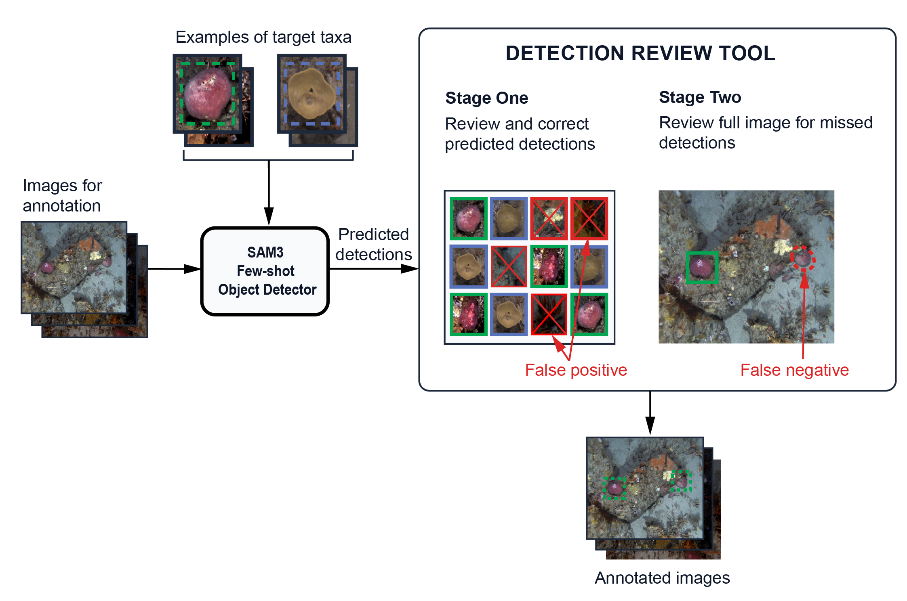

# Detection Review Tool

<p align="center">
    </a> <br>
    Graphical abstract from the accompanying paper: exemplar examples prompt
    the <a href="https://github.com/hdoi5324/SAM3-FSOD">SAM3 few-shot detector</a>,
    and its predicted detections are verified in this tool — Stage 1 reviews
    and corrects predicted detections, Stage 2 reviews the full image for
    missed detections — to produce the final annotated images.
</p>

A two-stage, timed web tool for reviewing object-detection predictions
against a directory of images. It is designed for the common situation in
which a detector (for example the few-shot detector in
[SAM3-FSOD](https://github.com/hdoi5324/SAM3-FSOD)) has produced a COCO-format
predictions file and a human needs to verify it quickly and consistently:

- **Stage 1 — review detections.** A thumbnail grid of predicted boxes.
  Confirm correct detections, ignore incorrect ones, fix the class or adjust
  the box where needed. Only confirmed detections are exported. A
  probability slider filters by score, and (optionally) example crops from a
  support set are shown per class.
- **Stage 2 — search for misses.** The full image with all boxes: draw boxes
  for detections the model missed, delete or edit boxes, and mark each image
  done.
- **Timers.** Each stage is timed per dataset/model, so review effort can be
  reported alongside accuracy. Timings are saved as the run progresses, and
  an interrupted session can be resumed where it left off.
- **Results.** On completion the tool writes the reviewed COCO file and, if
  ground truth was supplied, precision/recall/F1 (and COCO-style AP)
  comparing the raw predictions and the human-reviewed set against ground
  truth, including a per-class breakdown and a missed-detection browser.

The tool is standalone: it needs only an image directory and a predictions
file. It has no database and no dataset-platform dependencies.

## Install

Requires Python 3.10 or later.

```bash
git clone https://github.com/hdoi5324/detection-review-tool.git
cd detection-review-tool
python3 -m venv .venv
source .venv/bin/activate
pip install -e .
```

## Quickstart — your own predictions

The minimum inputs are an image directory and a COCO-format predictions
file:

```bash
detection-review \
  --images-dir /path/to/images \
  --predictions-coco /path/to/predictions.json \
  --host 127.0.0.1 --port 8080
```

Open `http://127.0.0.1:8080/`, sign in with the shared password (default
`review`; set `REVIEW_PASSWORD` or pass `--password` to change it), and enter
a reviewer name.

Optional inputs:

```bash
detection-review \
  --images-dir /path/to/images \
  --predictions-coco /path/to/predictions.json \
  --support-coco /path/to/support.json \
  --support-images-dir /path/to/support_images \
  --ground-truth-coco /path/to/ground_truth.json \
  --study-id my_study --dataset-id my_model
```

- `--support-coco` shows annotated example crops for each class in Stage 1.
  `--support-images-dir` defaults to `--images-dir`.
- `--ground-truth-coco` enables the ground-truth comparison on the results
  page.

### Predictions file format

A COCO-format JSON dictionary. Annotations need `bbox` in `[x, y, width,
height]` pixel coordinates; `score` is optional but enables the Stage 1
score filter and top-N selection described below.

```json
{
  "images":     [{"id": 1, "file_name": "img_001.jpg", "width": 1920, "height": 1080}],
  "annotations":[{"id": 1, "image_id": 1, "category_id": 1,
                  "bbox": [100, 200, 50, 40], "score": 0.83}],
  "categories": [{"id": 1, "name": "example class"}]
}
```

Image `file_name` values are resolved inside `--images-dir` (a path with
directories also falls back to its base name). Any detector that exports
COCO predictions — including SAM3-FSOD, whose runs write
`predictions_coco.json` — can be reviewed without conversion.

## Quickstart — worked example (Sponges)

`examples/sponges/` contains a complete, ready-to-run example on the
UTAS sponges data used with SAM3-FSOD: two slices of 100 query images
(`sponges_0_100`, `sponges_200_300`) with saved model predictions, ground
truth, and a shared support set (32 exemplar crops, included in
`examples/sponges/support_images/`; each support image is the annotated
crop itself, with its box covering the whole crop). The predictions were produced with the
SAM3-FSOD few-shot method (K = 10 exemplars per class).

The query images themselves are **not** in this repository. Download them
once via SAM3-FSOD (790 images, ~219 MB; they are fetched from public IMOS
object storage):

```bash
# in a sibling checkout
git clone https://github.com/hdoi5324/SAM3-FSOD.git
cd SAM3-FSOD && python scripts/download_utas_images.py
```

Then, from this repository (assuming the two checkouts sit side by side, as
the paths in `examples/sponges/manifest.json` expect):

```bash
cd detection-review-tool
pip install -e .
python scripts/detection_review_server.py \
  --manifest examples/sponges/manifest.json \
  --config config/review_config.json \
  --host 127.0.0.1 --port 8080
```

If SAM3-FSOD lives somewhere else, either edit `images_dir` in
`examples/sponges/manifest.json`, or review one slice at a time with direct
inputs, pointing at the image directory explicitly:

```bash
detection-review \
  --images-dir /path/to/SAM3-FSOD/datasets/utas_sponges_20054/images \
  --predictions-coco examples/sponges/slice_200_300/predictions.json \
  --support-coco examples/sponges/support.json \
  --support-images-dir examples/sponges/support_images \
  --ground-truth-coco examples/sponges/slice_200_300/ground_truth.json \
  --study-id sponges_example --dataset-id sponges_200_300
```

## Configuration

`config/review_config.json` controls Stage 1 selection and the in-app
guided tours:

```json
{
  "stage1_top_n": 50,
  "stage1_min_score": 0.1,
  "stage1_tour": [ { "target": "#grid", "title": "…", "body": "…" } ],
  "stage2_tour": [ { "target": "#img-canvas", "title": "…", "body": "…" } ]
}
```

Only detections with `score > stage1_min_score` are kept, then at most
`stage1_top_n` per image (highest scores first) are loaded for review.
Predictions without scores are all shown. Pass `--config` to choose a
different file. The defaults when no file is present are
`stage1_top_n: 100` and `stage1_min_score: 0.05`.

### Multi-dataset studies (manifests)

For timed studies comparing several models over the same images, group
datasets in a manifest JSON and pass `--manifest` (single study) or
`--manifest-dir` (a folder of manifests, chosen at sign-in). Datasets are
reviewed one at a time under one reviewer name; relative paths resolve
against the manifest file's directory.

```json
{
  "study_id": "my_study",
  "datasets": [
    {
      "id": "model_a",
      "images_dir": "/path/to/images",
      "predictions_coco": "/path/to/model_a_predictions.json",
      "support_coco": "/path/to/support.json",
      "support_images_dir": "/path/to/support_images",
      "ground_truth_coco": "/path/to/ground_truth.json"
    }
  ]
}
```

An optional `"settings"` object in the manifest overrides values from the
config file for that study.

## Outputs

Runs are written under `--output-dir` (default `outputs/`) as
`outputs/review_runs/<study_id>/<reviewer>/<dataset_id>_<timestamp>/`:

- `annotations/instances_reviewed.json` — confirmed/added detections as COCO
  (updated as the run progresses and again on completion)
- `annotations/review_overlay.json` — every reviewed box with its status,
  for reproducing the in-app views
- `timing.json` — per-stage elapsed times, counts, and run metadata
- `gt_comparison.json`, `gt_original.json` — reviewed-vs-ground-truth and
  raw-predictions-vs-ground-truth metrics (if ground truth was supplied)
- `review_state.json`, `session.json` — in-progress state so a reviewer can
  quit and resume

Thumbnails and exemplar crops are cached under `--data-root` (default
`data/`).

## Repository layout

| Path | Contents |
|---|---|
| `src/detection_review/` | Web app (FastAPI), review store, GT evaluation, config |
| `scripts/detection_review_server.py` | Server entry point (same as `detection-review`) |
| `scripts/detection_review_export.py` | Validate/summarise an exported reviewed-COCO file |
| `scripts/build_sponges_example.py` | Maintainer script that built `examples/sponges/` |
| `config/review_config.json` | Default review configuration |
| `examples/sponges/` | Worked example: predictions, ground truth, support, manifest |
| `tests/` | Unit tests (CPU) |

## Citation

This tool accompanies a journal paper on few-shot object detection; please
cite the software via [`CITATION.cff`](CITATION.cff):

```bibtex
@software{doig2026detectionreview,
  title  = {Detection Review Tool: two-stage timed review of object-detection predictions},
  author = {Doig, Heather and Perkins, Nicholas and Williams, Stefan},
  url    = {https://github.com/hdoi5324/detection-review-tool},
  year   = {2026}
}
```

## Acknowledgements

The imagery and associated annotations used in this study were accessed through the Squidle+ platform, supported by the Understanding of Marine Imagery (UMI) Sub-Facility. Data were sourced from Australia's Integrated Marine Observing System (IMOS) – IMOS is enabled by the National Collaborative Research Infrastructure Strategy (NCRIS).

## Licence

Licensed under the Apache License, Version 2.0 (see `LICENSE`). The example
query images are IMOS data downloaded by the user via SAM3-FSOD (see the
acknowledgement above); they are not redistributed here.
